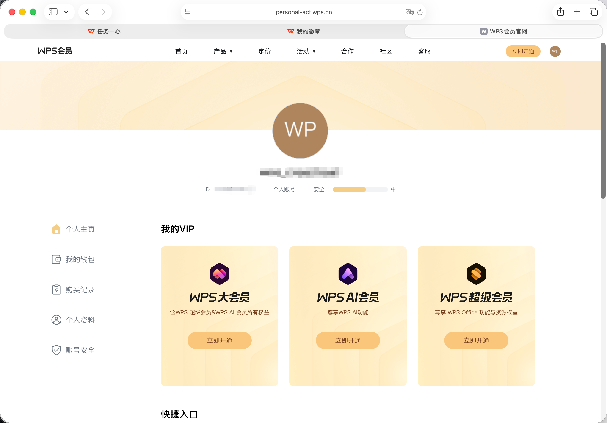

# WPS自动签到抽奖脚本

## ⚠️ 重要提示

**获取Cookie和User ID的正确方法：**

1. 🔑 **Cookie获取建议**：请抓取页面请求接口的Cookie，而不是浏览器地址栏的Cookie
   - 原因：接口请求的Cookie通常包含完整的认证信息，包括 `uid` 字段
   - 这样可以确保Cookie中包含 `user_id`，便于配置

2. 📝 **配置步骤**：
   - 先抓取签到接口的Cookie（包含 `uid=数字` 字段）
   - 从Cookie中提取 `uid` 的值作为 `user_id`
   - 将完整的Cookie和提取的 `user_id` 一起填写到配置文件中

3. ✅ **配置检查**：
   - 确保Cookie中包含 `uid` 字段
   - 确保配置文件中的 `user_id` 与Cookie中的 `uid` 值一致


## 功能说明

本脚本用于自动执行 WPS 多个活动页面的签到、试用和抽奖任务，支持多账号管理和推送通知功能。

### 主要功能

- ✅ 多账号管理
- ✅ 自动获取RSA加密公钥
- ✅ 自动生成加密参数
- ✅ 自动签到操作（任务中心 + 打卡免费领会员）
- ✅ 自动抽奖功能（可自定义抽奖次数）
- ✅ 任务中心签到、积分查询、抽奖
- ✅ 天天领福利：打卡免费领会员、会员免费试用、天天抽奖、第7天奖励
- ✅ CLI 参数化入口，按需选择执行页面
- ✅ 账号间随机延迟（3-10秒）
- ✅ 推送执行结果（支持 Bark 等多种通道）

### 页面说明

| 页面 | 功能 |
|---|---|
| `task_center` | 任务中心签到、积分查询、任务中心抽奖 |
| `daily_benefits` | 天天领福利：打卡签到 + 会员免费试用 + 天天抽奖 + 第7天奖励 |
| `all`（默认） | 依次执行上述两个页面 |

## 目录结构

```text
wps/
├── wps.py        # 统一入口（整合了原 main.py / task_center.py / daily_benefits.py 的全部功能）
├── README.md     # 本文档
└── img.png       # Cookie 获取步骤配图
```

## 配置说明

### 1. 账号配置

在项目根目录的 `config/token.json` 文件中配置 WPS 账号信息：

```json
{
  "wps": {
    "accounts": [
      {
        "account_name": "默认账号",
        "user_id": 123456789,
        "cookies": "YOUR_WPS_COOKIES_HERE",
        "user_agent": "Mozilla/5.0 (Macintosh; Intel Mac OS X 10_15_7) AppleWebKit/537.36 (KHTML, like Gecko) Chrome/142.0.0.0 Safari/537.36",
        "max_lottery_limit": 5
      },
      {
        "account_name": "账号2",
        "user_id": 987654321,
        "cookies": "ANOTHER_WPS_COOKIES",
        "user_agent": "Mozilla/5.0 ..."
      }
    ]
  }
}
```

**配置参数说明：**

- `account_name`: 账号名称，用于日志和通知中识别账号
- `user_id`: **【必需】** WPS用户ID，从 Cookie 中的 `uid` 字段获取（任务中心页面需要）
- `cookies`: **【必需】** WPS 登录 Cookie
- `user_agent`: 【可选】用户代理字符串，不填则使用默认值
- `max_lottery_limit`: 【可选】最大抽奖次数限制，默认为 5 次。即使账户有更多抽奖机会也会被截断

**⚠️ 重要提示：**
- `user_id` 是必需参数（仅任务中心页面用到），如果配置中没有 `user_id`，该账号将跳过任务中心签到（但天天领福利页面仍可正常执行）
- `max_lottery_limit` 用于控制抽奖次数，避免过度消耗抽奖机会

### 2. 获取Cookies和User ID

#### 方法一：从用户中心页面获取 user_id（推荐）

**最简单的获取方式：**

1. 打开浏览器，访问 [WPS用户中心](https://personal-act.wps.cn/center_page/user_index)
2. 登录你的WPS账号

3. 会直接显示用户id


**或者：**
- 打开开发者工具 (F12)
- 切换到 **Application (应用)** 标签
- 左侧选择 **Cookies** → `https://personal-act.wps.cn`
- 在右侧Cookie列表中找到 `uid`，其值就是你的 `user_id`

#### 方法二：从接口请求获取（推荐用于获取完整Cookie）

**获取完整Cookie和user_id：**

1. 打开浏览器，访问 [WPS签到页面](https://personal-act.wps.cn/)
2. 登录你的WPS账号
3. 打开浏览器开发者工具 (F12)
4. 切换到 **Network (网络)** 标签
5. 在页面上执行一次签到操作
6. 在网络请求列表中找到签到相关的接口请求（如 `sign_in`、`encrypt/key` 等）
7. 点击该请求，查看 **Request Headers（请求头）**
8. 复制 `Cookie` 字段的完整内容

**提取 user_id：**

从复制的Cookie字符串中找到 `uid=数字` 部分，例如：

```
uid=655953169; wps_sid=V02S...; csrf=...
    ↑
  这就是 user_id
```

在这个例子中，`user_id` 就是 `655953169`

**为什么要从接口请求获取Cookie？**
- ✅ 接口请求的Cookie包含完整的认证信息（包括 `uid` 字段）
- ✅ 确保Cookie是有效且最新的
- ✅ 避免Cookie不完整导致签到失败
- ⚠️ 不要使用浏览器地址栏复制Cookie，可能缺少必要字段

### 3. 推送配置（可选）

如需启用推送通知，需要在 `config/notification.json` 中配置 Bark 等通道参数，或在环境变量中配置：

```bash
export BARK_PUSH="YOUR_BARK_KEY"           # Bark推送密钥（必需）
export BARK_SOUND="birdsong"               # 推送声音（可选）
export BARK_GROUP="WPS签到"                # 推送分组（可选）
export BARK_LEVEL="active"                 # 推送级别（可选）
```

**推送通知内容包括：**
- 📊 总体统计（总账号数、成功数、失败数）
- 📋 每个账号的详细结果
  - `任务中心` 页面结果
  - `天天领福利` 页面结果
  - 页面内各功能模块的执行结果

## 使用方法

### 统一入口（全部执行）

```bash
cd script/wps
python wps.py
```

默认依次执行 `任务中心` → `天天领福利`。

### 指定执行单一页面

```bash
# 只跑任务中心（签到 + 抽奖）
python wps.py --page task_center

# 只跑天天领福利（打卡 + 试用 + 抽奖）
python wps.py --page daily_benefits
```

### 完整参数

```bash
python wps.py --help

# usage: wps.py [-h] [--page {task_center,daily_benefits,all}] [--config CONFIG]
#
# --page/-p   选择执行的页面（默认 all）
# --config/-c 指定账号配置文件路径（默认项目根目录 config/token.json）
```

### 定时任务

```bash
# 每天早上 9 点执行（全部页面）
0 9 * * * cd /path/to/ZaiZaiCat-Checkin/script/wps && python wps.py

# 每天凌晨 3 点只跑任务中心
0 3 * * * cd /path/to/ZaiZaiCat-Checkin/script/wps && python wps.py -p task_center
```

## 依赖库

```bash
pip install requests pycryptodome urllib3
```

> 本脚本依赖仓库的公共基础设施（`script/_shared/`、`notification/`），必须在完整仓库环境下运行。
> `urllib3` 为 `_shared/http_client.py` 的指数退避重试提供支持。

## 注意事项

1. **Cookie安全**
   - 请妥善保管你的Cookie信息
   - 不要分享给他人
   - 定期更新Cookie

2. **签到频率**
   - 建议每天执行一次
   - 避免频繁请求

3. **抽奖次数控制**
   - 可通过 `max_lottery_limit` 参数控制每次最多抽奖次数
   - 未设置时默认为 5 次
   - 避免过度消耗抽奖机会

4. **活动页面执行**
   - 默认依次执行两个页面；通过 `--page` 参数可选择只跑其中一个
   - `天天领福利` 依赖官方页面活动参数，页面内容后续可能随官方活动更新

5. **账号间延迟**
   - 多账号时自动在账号间添加随机延迟
   - 提高安全性，避免被检测为异常操作

6. **错误处理**
   - 脚本会自动处理网络错误和签到失败
   - Token 过期时会提示重新登录，并停止执行该账号后续页面
   - 如持续失败，请检查 Cookie 是否过期

7. **公钥更新**
   - 公钥会定期从服务器获取
   - 无需手动更新

## 更新日志

### v1.3.1 (2026-10-28)
- ✅ **收敛依赖**：删除了 wps.py 里内置的 70 行降级实现（裸 `requests.Session`、函数级重试、简化 logger 等），强制使用仓库公共模块 `_shared`
- ✅ **自动获得**：敏感字段日志脱敏（cookie/token 自动打码）、urllib3 指数退避重试（429/5xx 自动重试）、账号异常隔离
- ✅ **代码量**：v1.3 的 2220 行 → 1966 行，进一步净减 254 行
- ✅ **模式对齐**：路径 hack 改为和 `script/workbuddy` / `script/trae` 相同的三路径模式

### v1.3 (2026-10-28)
- ✅ **合并**：将原 `main.py` / `task_center.py` / `daily_benefits.py` / `api.py` / `benefit_entry.py` / `logging_utils.py` 六个文件整合为单一 `wps.py`
- ✅ **CLI 参数化**：通过 `--page` / `-p` 参数按需选择执行页面（`all` / `task_center` / `daily_benefits`）
- ✅ **去重**：统一了三个脚本中重复定义的 `_is_auth_expired_message`、`_safe_int`、`_parse_cookies` 等工具函数
- ✅ **独立运行兼容**：在缺失 `_shared` / `notification` 模块时自动降级，不推送但签到逻辑仍可跑通
- ✅ **代码行数**：原 13 个文件约 150KB → 单一文件 104KB
- ✅ **目录整洁**：`script/wps/` 只剩 `wps.py` + `README.md` + `img.png`

### v1.2 (2026-03-11)
- ✅ 将原有 WPS 功能拆分为 `任务中心` 独立页面脚本
- ✅ 新增 `天天领福利` 页面脚本
- ✅ 支持 `打卡免费领会员`
- ✅ 支持 `会员免费试用` 自动申请
- ✅ 支持 `天天抽奖`
- ✅ `main.py` 统一执行两个页面任务

### v1.1 (2025-12-18)
- ✅ 添加自动抽奖功能
- ✅ 支持自定义最大抽奖次数限制
- ✅ 添加签到奖励详细显示功能
- ✅ 添加每次抽奖结果展示
- ✅ 优化推送通知内容
- ✅ 改进错误处理机制

### v1.0 (2025-12-01)
- ✅ 重构代码结构，分离 API 和主逻辑
- ✅ 支持统一配置文件管理
- ✅ 支持多账号管理
- ✅ 自动获取 RSA 公钥
- ✅ 集成推送通知功能
- ✅ 完善日志输出

## 问题反馈

如遇到问题，请检查：
1. Cookie 是否有效
2. User ID 是否正确配置
3. 网络连接是否正常
4. 依赖库是否正确安装（`requests` / `pycryptodome`）
5. 配置文件格式是否正确
6. `max_lottery_limit` 参数是否合理设置

## 免责声明

本脚本仅供学习交流使用，请勿用于商业用途。使用本脚本产生的任何问题，由使用者自行承担。
